<div align="center">



# Metallurgical Engineer · Process Modeling · Data Analytics

Building computational tools, interactive simulators, and AI-assisted scientific projects.

[](https://ahmadishamulayadyakmal.github.io)
[](https://linkedin.com/in/ahmadishamulayadyakmal)
[](mailto:ishamulayadyakmal@gmail.com)

</div>

```text
╔════════════════════════════════════════════════════════════╗
║  SYSTEM       METALLURGICAL ENGINEERING WORKSPACE          ║
║  STATUS       ONLINE                                       ║
║  LOCATION     EAST JAVA, INDONESIA                         ║
║  FOCUS        NUMERICAL MODELING & AI-ASSISTED DEVELOPMENT ║
║  MISSION      TURN COMPLEX ENGINEERING DATA INTO TOOLS     ║
╚════════════════════════════════════════════════════════════╝
```

## `> whoami`

Metallurgical engineer and M.Eng. candidate exploring the intersection of **metallurgy, computation, data, and artificial intelligence**.

I develop computational tools, process visualizations, interactive simulators, and AI-assisted engineering projects with a practical, experimental mindset.

## `> cat current_focus.txt`

- Numerical modeling of inclusion evolution in continuous casting
- CFD and FEA using ANSYS Fluent and ANSYS Workbench
- Metallurgical and laboratory data analysis with Python
- Interactive engineering calculators and process simulators
- Scientific dashboards and data visualizations
- AI-assisted development and rapid scientific prototyping

## `> ls ./engineering_stack`

<div align="center">

[](https://python.org)
[](https://fortran-lang.org)
[](https://www.ansys.com)
[](https://numpy.org)
[](https://pandas.pydata.org)

[](https://developer.mozilla.org/docs/Web/JavaScript)
[](https://developer.mozilla.org/docs/Web/HTML)
[](https://developer.mozilla.org/docs/Web/CSS)
[](https://git-scm.com)
[](https://learn.microsoft.com/fabric)

</div>

## `> ls ./projects`

| Metallurgical Systems | Engineering Tools |
|---|---|
| Inclusion evolution analysis | Heat-transfer calculators |
| Continuous-casting process studies | Fluid-flow visualizers |
| Metallurgical data visualizations | Process simulators |
| SEM-EDS and laboratory utilities | Engineering design calculators |
| Laboratory report automation | Interactive technical dashboards |

| Web & AI Experiments | Open-Source Exploration |
|---|---|
| AI-assisted engineering applications | Scientific prototyping |
| Interactive technical websites | Data-processing tools |
| Rapid prototypes | AI-assisted documentation |
| Engineering data dashboards | Experimental automation |

## `> ./generate_insights.py`

<div align="center">


</div>

## `> cat education.log`

```text
[2024—2027] M.Eng. Metallurgical Engineering
             University of Science and Technology Beijing
             LPDP–Tsingshan Group Scholarship

[2019—2023] B.Eng. Electrical Engineering
             University of Jember
             Djarum Beasiswa Plus Awardee
```

## `> ./connect --network`

<div align="center">

**East Java, Indonesia · Open to relocation**

[Portfolio](https://ahmadishamulayadyakmal.github.io) · [LinkedIn](https://linkedin.com/in/ahmadishamulayadyakmal) · [Email](mailto:ishamulayadyakmal@gmail.com)

</div>


